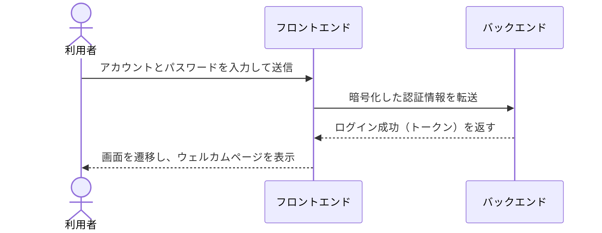

<!--renderComp=Anchor,id=diagram-text-->
<!--renderComp=MultiLang-->
## {en: "Text Diagram", jp: "テキスト図表"}

<!--renderComp=MultiLang,type=paragraphs,languages=[en,jp]-->
```markdown
`DiagramText` displays text diagrams that remain readable in plain Markdown, with the box-drawing lines aligned in the browser. Full-width characters such as Japanese occupy 2 cells while alphanumeric characters and box-drawing lines occupy 1 cell, so the borders stay aligned even when font fallbacks are mixed.

`DiagramText` は、Markdown だけでも読めるテキスト図を、ブラウザー上で罫線が揃うように表示します。日本語などの全角文字を 2 セル、英数字と罫線を 1 セルとして配置するため、フォントのフォールバックが混在しても境界線がずれません。
```

<!--renderComp=MultiLang-->
### {en: "Syntax", jp: "構文"}

````markdown
<!--renderComp=DiagramText-->
```text
┌──────────────────────────────────────────────┐
│ 操作ツールバー                               │
├──────────────────────┬───────────────────────┤
│ ファイル一覧         │ 検索結果一覧          │
├──────────────────────┴───────────────────────┤
│ 選択カテゴリのファイル一覧                   │
└──────────────────────────────────────────────┘
```
````

<!--renderComp=MultiLang-->
### {en: "Display example", jp: "表示例"}

<!-- AI agent should not remove the text diagram below-->
<!--renderComp=DiagramText-->
```text
┌──────────────────────────────────────────────┐
│ 操作ツールバー                               │
├──────────────────────┬───────────────────────┤
│ ファイル一覧         │ 検索結果一覧          │
├──────────────────────┴───────────────────────┤
│ 選択カテゴリのファイル一覧                   │
└──────────────────────────────────────────────┘
```

<!--renderComp=MultiLang-->
### {en: "Authoring and maintenance", jp: "作成と保守"}

<!--renderComp=MultiLang,type=list,languages=[en,jp]-->
```markdown
- Place `<!--renderComp=DiagramText-->` directly before a `text` code block. Since plain Markdown shows it as a code block, the content stays readable outside the dedicated page.
- `<!--renderComp=DiagramText-->` を `text` コードブロックの直前に置きます。通常の Markdown ではコードブロックとして読めるため、専用画面以外でも内容を確認できます。
- Use the horizontal border lines as the reference for the outer frame and the positions of `┬` and `┴`. The component automatically adjusts the vertical borders of adjacent lines to those positions.
- 横罫線の行を基準に、外枠と `┬`／`┴` の位置を決めます。コンポーネントは、その位置へ隣接行の縦罫線を自動調整します。
- The number of Japanese characters and the number of display columns are not the same. When counting spaces by hand, treat a full-width character as 2 columns, and a half-width character or box-drawing line as 1 column.
- 日本語の文字数と表示列数は同じではありません。空白を手で数える時は、全角文字を 2 列、半角文字と罫線を 1 列として扱います。
- Use spaces, not tabs. Keep labels within their cell width, and update the horizontal borders above and below together after adding cells or changing widths.
- タブではなく空白を使います。ラベルが区画幅を超えないようにし、区画の追加や幅変更後は上下の横罫線も一緒に更新します。
- The automatic adjustment only grows or shrinks the spaces directly before a vertical border. It never truncates or wraps characters, so widen the diagram when content is long.
- 自動調整は縦罫線の直前にある空白だけを増減します。文字を切り詰めたり折り返したりしないため、内容が長い場合は図の横幅を広げます。
```

<!--renderComp=Anchor,id=diagram-mermaid-->
<!--renderComp=MultiLang-->
## {en: "Mermaid Diagram", jp: "Mermaid 図表"}

<!--renderComp=MultiLang-->
### {en: "Sequence diagram", jp: "シーケンス図"}

<!--renderComp=MultiLang,type=paragraphs,languages=[en,jp]-->
```markdown
A sequence diagram shows in which order processing is handed over between the user, the frontend, and the backend.

利用者、フロントエンド、バックエンドの間で、処理がどの順番で受け渡されるかを表します。
```

<!--renderComp=MultiLang-->
#### {en: "Syntax", jp: "構文"}

````markdown
<!--renderComp=DiagramMermaid,title=ログイン処理のシーケンス図,displayMode=contain-->

````

<!--renderComp=MultiLang-->
#### {en: "Display example", jp: "表示例"}

<!--renderComp=DiagramMermaid,title=ログイン処理のシーケンス図,displayMode=contain-->


<!--renderComp=Anchor,id=diagram-er-->
<!--renderComp=MultiLang-->
## {en: "ER Diagram", jp: "ER 図"}

<!--renderComp=MultiLang,type=paragraphs,languages=[en,jp]-->
```markdown
`DiagramER` draws tables, their columns, and the relationships between them from YAML. Tables can be dragged; the toolbar copies the YAML or opens the diagram enlarged. In edit mode, the insert menu offers it as `DiagramER` with a starting diagram of two tables.

`DiagramER` は、YAML からテーブル、列、テーブル間のリレーションを描画します。テーブルはドラッグで移動できます。ツールバーから YAML をコピーしたり、拡大表示したりできます。編集モードでは、挿入メニューに `DiagramER` として表示され、二つのテーブルからなる図で始まります。
```

<!--renderComp=MultiLang-->
### {en: "Syntax", jp: "構文"}

````markdown
<!--renderComp=DiagramER,title=Orders,height=420-->
```yaml
tables:
  - id: customer
    name: customer
    nameLogical: Customer
    columns:
      - { id: id, name: id, type: uuid, key: PK }
      - { id: name, name: name, type: text }
  - id: order
    name: order
    nameLogical: Order
    columns:
      - { id: id, name: id, type: uuid, key: PK }
      - { id: customerId, name: customer_id, type: uuid, key: FK }
relationships:
  - id: orderCustomer
    label: places
    source: { tableId: customer, columnId: id }
    target: { tableId: order, columnId: customerId }
```
````

<!--renderComp=MultiLang-->
### {en: "Display example", jp: "表示例"}

<!--renderComp=DiagramER,title=Orders,height=420-->
```yaml
tables:
  - id: customer
    name: customer
    nameLogical: Customer
    columns:
      - { id: id, name: id, type: uuid, key: PK }
      - { id: name, name: name, type: text }
  - id: order
    name: order
    nameLogical: Order
    columns:
      - { id: id, name: id, type: uuid, key: PK }
      - { id: customerId, name: customer_id, type: uuid, key: FK }
relationships:
  - id: orderCustomer
    label: places
    source: { tableId: customer, columnId: id }
    target: { tableId: order, columnId: customerId }
```

<!--renderComp=Anchor,id=proxy-connection-diagram-->
<!--renderComp=MultiLang-->
## {en: "Interactive diagram", jp: "インタラクティブ図"}

<!--renderComp=MultiLang,type=paragraphs,languages=[en,jp]-->
```markdown
`ProxyConnectionDiagram` is a fixed interactive diagram: drag to pan, scroll to zoom, click a node for its details. It is not driven by data; the text of its block is only what a plain Markdown viewer shows.

`ProxyConnectionDiagram` は固定のインタラクティブ図です。ドラッグで移動、スクロールで拡大縮小し、ノードをクリックすると詳細を表示します。データでは制御されず、ブロックのテキストは通常の Markdown ビューアーで表示される内容です。
```

<!--renderComp=ProxyConnectionDiagram-->
```text
Connection route through the authenticated proxy; replaced by the ProxyConnectionDiagram component.
```
