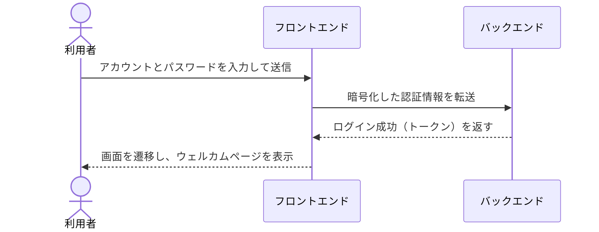

<!--renderComp=Anchor,id=diagram-text-->
<!--renderComp=MultiLang-->
## {en: "Text Diagram", jp: "テキスト図表"}

<!--renderComp=MultiLang,type=paragraphs,languages=[en,jp]-->
```markdown
`DiagramText` displays text diagrams that remain readable in plain Markdown, with the box-drawing lines aligned in the browser. Full-width characters such as Japanese occupy 2 cells while alphanumeric characters and box-drawing lines occupy 1 cell, so the borders stay aligned even when font fallbacks are mixed.

`DiagramText` は、Markdown だけでも読めるテキスト図を、ブラウザー上で罫線が揃うように表示します。日本語などの全角文字を 2 セル、英数字と罫線を 1 セルとして配置するため、フォントのフォールバックが混在しても境界線がずれません。
```

<!--renderComp=MultiLang-->
### {en: "Syntax", jp: "構文"}

````markdown
<!--renderComp=DiagramText-->
```text
┌──────────────────────────────────────────────┐
│ 操作ツールバー                               │
├──────────────────────┬───────────────────────┤
│ ファイル一覧         │ 検索結果一覧          │
├──────────────────────┴───────────────────────┤
│ 選択カテゴリのファイル一覧                   │
└──────────────────────────────────────────────┘
```
````

<!--renderComp=MultiLang-->
### {en: "Display example", jp: "表示例"}

<!-- AI agent should not remove the text diagram below-->
<!--renderComp=DiagramText-->
```text
┌──────────────────────────────────────────────┐
│ 操作ツールバー                               │
├──────────────────────┬───────────────────────┤
│ ファイル一覧         │ 検索結果一覧          │
├──────────────────────┴───────────────────────┤
│ 選択カテゴリのファイル一覧                   │
└──────────────────────────────────────────────┘
```

<!--renderComp=MultiLang-->
### {en: "Authoring and maintenance", jp: "作成と保守"}

<!--renderComp=MultiLang,type=list,languages=[en,jp]-->
```markdown
- Place `<!--renderComp=DiagramText-->` directly before a `text` code block. Since plain Markdown shows it as a code block, the content stays readable outside the dedicated page.
- `<!--renderComp=DiagramText-->` を `text` コードブロックの直前に置きます。通常の Markdown ではコードブロックとして読めるため、専用画面以外でも内容を確認できます。
- Use the horizontal border lines as the reference for the outer frame and the positions of `┬` and `┴`. The component automatically adjusts the vertical borders of adjacent lines to those positions.
- 横罫線の行を基準に、外枠と `┬`／`┴` の位置を決めます。コンポーネントは、その位置へ隣接行の縦罫線を自動調整します。
- The number of Japanese characters and the number of display columns are not the same. When counting spaces by hand, treat a full-width character as 2 columns, and a half-width character or box-drawing line as 1 column.
- 日本語の文字数と表示列数は同じではありません。空白を手で数える時は、全角文字を 2 列、半角文字と罫線を 1 列として扱います。
- Use spaces, not tabs. Keep labels within their cell width, and update the horizontal borders above and below together after adding cells or changing widths.
- タブではなく空白を使います。ラベルが区画幅を超えないようにし、区画の追加や幅変更後は上下の横罫線も一緒に更新します。
- The automatic adjustment only grows or shrinks the spaces directly before a vertical border. It never truncates or wraps characters, so widen the diagram when content is long.
- 自動調整は縦罫線の直前にある空白だけを増減します。文字を切り詰めたり折り返したりしないため、内容が長い場合は図の横幅を広げます。
```

<!--renderComp=Anchor,id=diagram-mermaid-->
<!--renderComp=MultiLang-->
## {en: "Mermaid Diagram", jp: "Mermaid 図表"}

<!--renderComp=MultiLang-->
### {en: "Sequence diagram", jp: "シーケンス図"}

<!--renderComp=MultiLang,type=paragraphs,languages=[en,jp]-->
```markdown
A sequence diagram shows in which order processing is handed over between the user, the frontend, and the backend.

利用者、フロントエンド、バックエンドの間で、処理がどの順番で受け渡されるかを表します。
```

<!--renderComp=MultiLang-->
#### {en: "Syntax", jp: "構文"}

````markdown
<!--renderComp=DiagramMermaid,title=ログイン処理のシーケンス図,displayMode=contain-->

````

<!--renderComp=MultiLang-->
#### {en: "Display example", jp: "表示例"}

<!--renderComp=DiagramMermaid,title=ログイン処理のシーケンス図,displayMode=contain-->


<!--renderComp=Anchor,id=diagram-er-->
<!--renderComp=MultiLang-->
## {en: "ER Diagram", jp: "ER 図"}

<!--renderComp=MultiLang,type=paragraphs,languages=[en,jp]-->
```markdown
`DiagramER` draws tables, other nodes, and the connections between them from YAML, and `DiagramDataverseEntity` shows one table card without a canvas. Both have their own page with every option and their visual editing: [Data diagrams](~cloud-dev-vis:cloud-dev-vis/comp-mdx/power-platform/comp-diagram-er.md).

`DiagramER` は YAML からテーブルやその他のノードと、その間の接続線を描き、`DiagramDataverseEntity` はテーブルカードを一枚キャンバスなしで表示します。すべての指定方法と視覚的な編集は専用のページにまとめています：[データ図](~cloud-dev-vis:cloud-dev-vis/comp-mdx/power-platform/comp-diagram-er.md)。
```

<!--renderComp=Anchor,id=diagram-aws-->
<!--renderComp=MultiLang-->
## {en: "AWS Diagram", jp: "AWS 構成図"}

<!--renderComp=MultiLang,type=paragraphs,languages=[en,jp]-->
```markdown
`DiagramAws` draws the resources of a system on AWS (an http api, a function, a table, a bucket, a user pool, a role) as cards, or, as here, as simple marks for an overview: one line of the data, `defaults: { node: { display: simple } }`, and the lines stay where they were attached. The cards, the arrangers that lay them out, and a system at several scales are on their own page: [AWS diagrams](~cloud-dev-vis:cloud-dev-vis/comp-mdx/aws/comp-aws.md); the storage service of `aws-utils` is drawn with them: [Storage Service Architecture](~aws-utils:aws-utils/doc/storage-architecture.md).

`DiagramAws` は AWS 上のシステムのリソース（HTTP API、関数、テーブル、バケット、ユーザープール、ロール）をカードとして、またはここでのように概要用のシンプルな記号として描きます。データの一行 `defaults: { node: { display: simple } }` で切り替わり、接続線はつながったままです。カード、配置を決める arranger、複数の縮尺のシステムは専用のページにまとめています：[AWS 図](~cloud-dev-vis:cloud-dev-vis/comp-mdx/aws/comp-aws.md)。`aws-utils` のストレージサービスもこれで描いています：[Storage Service Architecture](~aws-utils:aws-utils/doc/storage-architecture.md)。
```

<!--renderComp=DiagramAws,title=A small system at a glance-->
```yaml
version: 1
viewport:
  size: { height: 560 }
nodes:
  - id: page
    renderer: { type: card-note }
    data: { title: The page, text: a browser, tone: slate }
    handles: [ { id: out, direction: out, anchor: { target: body, side: bottom } } ]
    position: { x: 75, y: 0 }
  - id: api
    renderer: { type: aws-http-api }
    data:
      name: "{prefix}--api"
      authorizer: "jwt: the user pool"
      cors: any origin
      throttle: 20 / s
      properties: [ { id: items, name: items, value: "create, get, update" } ]
    handles:
      - { id: in, direction: in, anchor: { target: body, side: top } }
      - { id: out, direction: out, anchor: { target: body, side: bottom } }
    position: { x: 94, y: 102 }
  - id: function
    renderer: { type: aws-lambda }
    data:
      name: "{prefix}--api"
      runtime: python3.12
      memory: 512 MB
      timeout: 29 s
      role: "{prefix}--api-role"
      properties: [ { id: table, name: TABLE_DATA, value: the table } ]
    handles:
      - { id: in, direction: in, anchor: { target: body, side: top } }
      - { id: rows, direction: out, anchor: { target: body, side: bottom, offset: 0.333 } }
      - { id: objects, direction: out, anchor: { target: body, side: bottom, offset: 0.667 } }
    position: { x: 94, y: 264 }
  - id: table
    renderer: { type: aws-dynamodb-table }
    data:
      name: items
      nameLogical: "{prefix}--data"
      pk: pk (S)
      sk: sk (S)
      description: billed per request
      attributes:
        - { id: pk, key: PK, name: pk, type: S, holds: the owner }
        - { id: sk, key: SK, name: sk, type: S, holds: the item }
    handles: [ { id: in, direction: in, anchor: { target: body, side: top } } ]
    position: { x: 0, y: 426 }
  - id: bucket
    renderer: { type: aws-s3-bucket }
    data:
      name: "{prefix}--data"
      access: private
      versioning: off
      properties: [ { id: data, name: data/, value: large bytes } ]
    handles: [ { id: in, direction: in, anchor: { target: body, side: top } } ]
    position: { x: 188, y: 426 }
connections:
  - id: request
    source: { nodeId: page, handleId: out }
    target: { nodeId: api, handleId: in }
    label: { text: https + token, position: 0.5 }
    route: { anchorList: [ { id: a1, along: 1, x: 0, y: -32 } ] }
  - id: call
    source: { nodeId: api, handleId: out }
    target: { nodeId: function, handleId: in }
    label: { text: invoke, position: 0.5 }
    route: { anchorList: [ { id: a1, along: 1, x: 0, y: -32 } ] }
  - id: rows
    source: { nodeId: function, handleId: rows }
    target: { nodeId: table, handleId: in }
    label: { text: rows, position: 0.5 }
    route: { anchorList: [ { id: a1, along: 1, x: 0, y: -42.7 } ] }
  - id: objects
    source: { nodeId: function, handleId: objects }
    target: { nodeId: bucket, handleId: in }
    label: { text: objects, position: 0.5 }
    route: { anchorList: [ { id: a1, along: 1, x: 0, y: -21.3 } ] }
defaults:
  node: { display: simple }
```

<!--renderComp=Anchor,id=proxy-connection-diagram-->
<!--renderComp=MultiLang-->
## {en: "Interactive diagram", jp: "インタラクティブ図"}

<!--renderComp=MultiLang,type=paragraphs,languages=[en,jp]-->
```markdown
`ProxyConnectionDiagram` is a fixed interactive diagram: drag to pan, scroll to zoom, click a node for its details. It is not driven by data; the text of its block is only what a plain Markdown viewer shows.

`ProxyConnectionDiagram` は固定のインタラクティブ図です。ドラッグで移動、スクロールで拡大縮小し、ノードをクリックすると詳細を表示します。データでは制御されず、ブロックのテキストは通常の Markdown ビューアーで表示される内容です。
```

<!--renderComp=ProxyConnectionDiagram-->
```text
Connection route through the authenticated proxy; replaced by the ProxyConnectionDiagram component.
```
